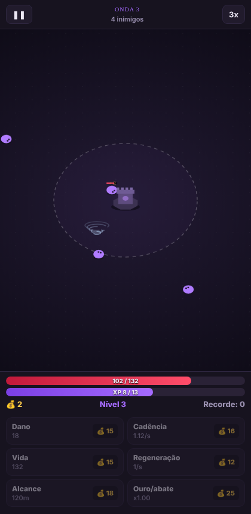

# 🏰 Torre Guardiã

   

Jogo de **tower defense idle** feito com **HTML, CSS e JavaScript puro** (sem bibliotecas), roda direto no navegador do PC ou do celular.

  

## 🎮 Como jogar

A torre fica no centro e **atira sozinha** nos inimigos que chegam de todos os lados. Sua missão é sobreviver ao máximo de ondas:

- 💰 **Ouro** dos inimigos derrotados compra melhorias: Dano, Cadência, Vida, Regeneração, Alcance e Ouro por abate
- ⭐ Ao subir de **nível**, escolha 1 entre 3 **poderes**: Tiro Múltiplo, Raio Encadeado, Golpe Crítico, Campo Tóxico, Gelo, Explosivo, Vampirismo e Tornado
- 👹 **Chefão** a cada 10 ondas
- ⏩ Velocidade 1x / 2x / 3x e recorde salvo no navegador

## ▶️ Rodar localmente

Baixe o repositório e abra o arquivo `index.html` no navegador. Só isso.

## 🧠 O que pratiquei neste projeto

- **Game loop** com `requestAnimationFrame` (atualizar → desenhar, 60x por segundo)
- Desenho 2D com a **Canvas API**
- Manipulação de **listas de objetos** (inimigos, projéteis, efeitos)
- **Funções** para combate, dano, abates e subida de nível
- Balanceamento com crescimento exponencial (`Math.pow`)
- Interface responsiva com HTML/CSS e `localStorage` para o recorde

## 🛠️ Tecnologias

`HTML5` · `CSS3` · `JavaScript (ES6+)` · `Canvas 2D`

---

Desenvolvido por **John Herbet Silva Trindade**, estudante de Análise e Desenvolvimento de Sistemas. Veja mais projetos no [meu perfil](https://github.com/JohnSilva90).
